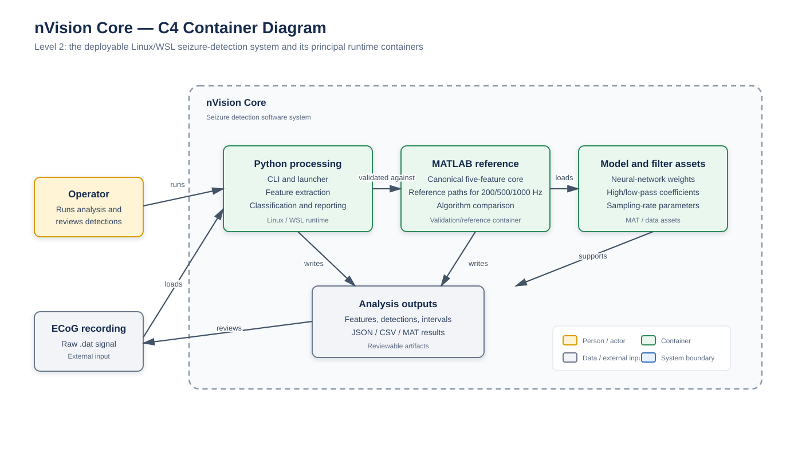

# nVision Core

Linux/WSL port of the nVision seizure-detection core, preserving the MATLAB reference implementation and five-feature processing pipeline.

The diagram shows the system boundary, runtime containers, core data assets, and analysis outputs.

Reference:
Kamintsky L, van Hameren G, Weissberg I, Moradi P, Prager O, Ahmad AA, et al. An algorithm for seizure detection in rodents. Epilepsia Open. 2025; 00: 1–13. https://doi.org/10.1002/epi4.70070
