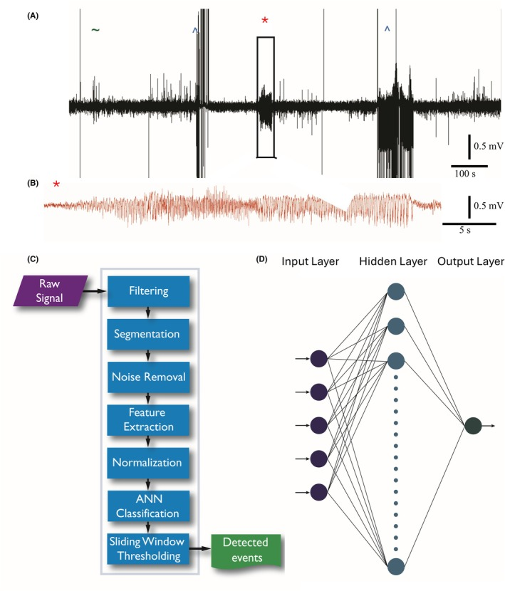
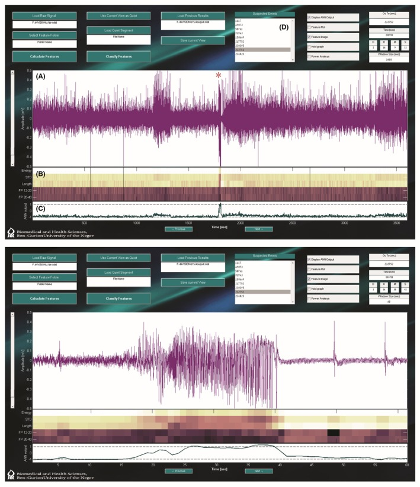
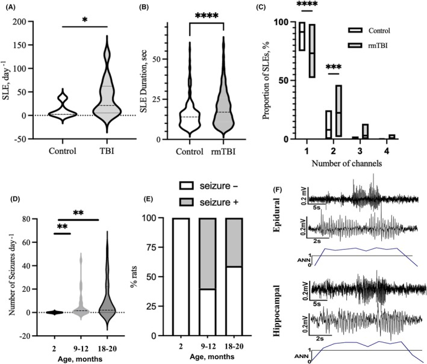

# nVision Core

Linux/WSL port of the nVision seizure-detection algorithm, preserving the MATLAB reference implementation and five-feature processing pipeline.

* * *

## ◈ What Is This?

nVision Core processes intracranial EEG recordings through filtering, segmentation, feature extraction, normalization, ANN classification, and sliding-window thresholding.

* * *

## ◈ Capability Map

```text
INPUT                         PIPELINE                         OUTPUT
────────────────────────────────────────────────────────────────────────
ECoG .dat recording     ──▶   Filtering                       ──▶   Features
200 / 500 / 1000 Hz     ──▶   Five-feature extraction          ──▶   Detections
                            ANN classification                ──▶   CSV / JSON / MAT
```

* * *

## ◈ Architecture


* * *

## ◈ Figure 1 — System Overview



> Trace sample of mouse iEEG. (A) 1100 s of an iEEG trace containing a *seizure and ^noise. (B) Magnified view of the seizure segment. (C) System block diagram. The telemetrically acquired iEEG signals are filtered and divided into 2‐s segments with a 1‐s overlap. Features are extracted from each segment, normalized, and fed to the ANN for classification. The ANN output undergoes sliding window‐thresholding to produce the time coordinates of the detected events. (D) The architecture of the constructed ANN. An input layer of 5 nodes, a hidden layer of 50 neurons, and a single neuron output layer.

* * *

## ◈ Figure 3 — Graphical User Interface



> Graphical user interface. Upper panel: (A) 1 h iEEG trace containing a detected seizure (indicated with *) in a recording of a pilocarpine‐treated mouse. (B) The five normalized features representing the displayed trace. (C) The corresponding output of the ANN. (D) Coordinates of all 9 detected seizures in the 3‐day‐long recording. Lower panel: 60 s display of the above seizure.

* * *

## ◈ Figure 4 — Seizure Detection in Rats



> Seizure detection in injured and aged rats. (A) TBI is linked with a higher occurrence of seizure events that are longer in duration (B). (C) In TBI animals, a significantly larger proportion of SLEs were simultaneously detected by two or more electrodes compared to controls (p < 0.0001; two‐way ANOVA). (D) Average seizure frequency in older (9–12 and 12–18 months) is significantly higher compared to young rats (2 months). (E) The proportion of animals with seizures is higher in animals older than 9 months compared to 2‐month‐old rats. (F) Representative traces and corresponding ANN score from epidural and hippocampal recordings in rats. *p < 0.05; **p < 0.01; ***p < 0.001; ****p < 0.0001.

* * *

## ◈ Reference

Kamintsky L, van Hameren G, Weissberg I, Moradi P, Prager O, Ahmad AA, et al. [An algorithm for seizure detection in rodents](https://doi.org/10.1002/epi4.70070). *Epilepsia Open*. 2025. Open access under the [CC BY-NC-ND 4.0 license](https://creativecommons.org/licenses/by-nc-nd/4.0/).
